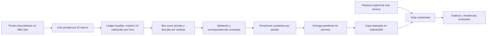

# NBA Stat: infraestructura privada preparada, conexión desactivada

Revisión documental: 21/10/2026. **No se han realizado consultas autenticadas, creado tokens, descargado box scores reales ni publicado estadísticas NBA Stat.** No hay cambios en la web activa ni en sus bases personales. Este módulo no se importa desde `main.jsx`, ningún componente ni el workflow del calendario.

## Qué sabemos y qué no

La [documentación oficial](https://nbastat.io/developers/api) describe `GET /api/v1/games/{game_id}/boxscore`, autenticación Bearer y diez consultas por ventana móvil de sesenta minutos. Los IDs son internos; no equivalen a los de NBA, ESPN o BALLDONTLIE. Las colecciones usan página y tamaño de hasta cien. El endpoint de box score puede devolver jugadores vacíos para encuentros pendientes.

La documentación consultada no muestra un esquema completo de los campos del box score, sus unidades de minutos, DNP, totales de equipo o cuartos. Tampoco acredita por sí sola la cobertura 2026-27. No se ha encontrado una especificación OpenAPI enlazada que resuelva esos campos. `decodeNbaStatResponse()` lanza deliberadamente `WIRE_SCHEMA_UNVERIFIED`; **no se ha escrito un adaptador que adivine claves del JSON real**.

El usuario declara una autorización por correo para consultas automáticas, almacenamiento privado, análisis y presentación personal no comercial con atribución. Se registra como `reported-by-user`; no se ha inspeccionado ni publicado ese correo. Las [condiciones públicas](https://nbastat.io/terms), especialmente §§4 y 8, mantienen restricciones y no conceden por el mero acceso API derechos generales de redistribución. Quedan pendientes la aclaración de JSON públicos, 2026-27 y cualquier permiso de origen necesario para el uso concreto. Citar la fuente no sustituye esos permisos.

`nbastat-source.json` está desactivado. El cliente exige resolver explícitamente los permisos pendientes antes de cualquier llamada. Si se deniega JSON público pero se confirma el uso privado y la cobertura, solo será viable el canal privado; esa denegación no invalida por sí sola una prueba privada autorizada. El modo futuro `private-inspection` permitirá recoger una primera muestra privada para revisar su esquema; el modo de ingestión exigirá además un esquema verificado. **La configuración actual no habilita ninguno**. No hay entradas ejecutables ni programaciones nuevas.

## Archivos preparados

- `scripts/lib/nbastat/client.mjs`: transporte exclusivamente de servidor, bloqueo por configuración, rutas documentadas de identificación/descubrimiento/box score, cuota compartida y errores sin cuerpos crudos ni credenciales.
- `scripts/lib/nbastat/private-store.mjs`: ledger durable en una subcarpeta de `work/` (ya ignorada), escritura atómica, archivo `0600`, directorio `0700` y bloqueo exclusivo entre procesos. No usa `public/` ni artefactos. No guarda el token. Un lock dejado por un proceso muerto requiere revisión manual; no se elimina a ciegas ni se reinicia la cuota.
- `src/data/nbastat/updates.js`: correspondencias revisadas, contrato interno, validación, DNP separados, revisiones por partido, vista combinada de lectura y cola deduplicada con reintentos diferidos.
- `src/data/nbastat/store.js`: capa IndexedDB **independiente**, `nba-tendencias-nbastat-private`, con revisión local para evitar sobrescrituras entre pestañas. No se abre en la aplicación actual. Las pruebas la abren únicamente en `fake-indexeddb`.
- `tests/fixtures/nbastat.js`: ejemplos mínimos **FICTICIOS**, con nombres e IDs inventados y `synthetic: true`, en fechas de 2031. Representan nuestro contrato propuesto, **no una respuesta real del proveedor**. Sus filas convertidas también indican «DEMOSTRACIÓN FICTICIA» y no pueden combinarse con un historial marcado como real/importado no sintético. No se incluyen en el build ni se presentan como partidos NBA reales.

## Flujo futuro y separación del historial

No se actualiza `nba-tendencias-personal`, ni sus 93.224 registros, ni las bases de las 519 plantillas y las 434 identidades vinculadas. Las retiradas siguen en su directorio actual. El calendario BALLDONTLIE permanece independiente. Las funciones nuevas no cambian esos estados ni asignan equipos actuales a partir del box score.

Las correspondencias del nuevo proveedor se guardarán por separado: ID NBA Stat → clave NBA/ESPN ya contrastada. Exigen IDs, fechas de nacimiento coincidentes, revisión y referencias a ambos perfiles. Una URL del detalle API identifica su ID interno; habrá que verificar en privado qué campos de identidad ofrece. Si no permite comprobar la identidad, se mantiene pendiente. No se compara solo el nombre ni se reutiliza el número NBA como si fuera un ID NBA Stat.

Los registros usan `nbastat:game:ID:player:ID` y `nbastat:game:ID:team:ID`. El mismo partido recibe revisiones, no nuevos IDs. Las equivalencias con partidos ESPN/BDL se revisarán expresamente. Si ya hay registros del mismo encuentro en el historial, o un posible cruce del mismo día/equipos, la vista lo retiene como conflicto y evita sumarlo dos veces; no modifica la base ni enlaza partidos automáticamente por fecha. Este control conservador puede requerir revisión de un aplazado o una fecha ambigua.

La configuración y el código del módulo se pueden revisar sin publicar las correspondencias, respuestas privadas ni archivos históricos. Un esquema de importación/entrega público no equivale a permiso para publicar su contenido.

## Actuaciones, equipos y correcciones

El contrato interno requiere fecha inequívoca, temporada, marcador final, ambos equipos revisados y confirmación de que el lote está completo. Esa confirmación no existe aún como campo comprobado del proveedor: deberá establecerla el decoder después de revisar una muestra y los criterios de completitud. El contrato exige todos los indicadores de jugador usados por el motor; rechaza ausencias y tiros/puntos contradictorios.

- `played: true`: actuación realmente acreditada. Puede tener cero puntos; cero por sí solo no significa DNP. Minutos se expresan en unidades decimales del contrato, pendientes de conversión del formato real.
- `played: false`: DNP comunicado, separado de las actuaciones. Datos positivos contradictorios se rechazan. No aparece como un partido a cero en los gráficos.
- Participación desconocida o identidad no enlazada: lote pendiente; no se clasifica como «sin historial» ni se escribe una revisión parcial.
- Un jugador ausente del box score no se considera DNP por comparación con la plantilla. No se crean actuaciones para completar una lista.
- Los puntos individuales deben sumar el marcador. Para equipos se exige ambos conjuntos, totales y periodos reales, incluidas prórrogas si existen. Se contrastan tiros y otros totales aditivos; los rebotes de equipo pueden incluir rebotes no asignados a jugadores y no se fuerza su igualdad.
- Si no se dispone de datos de equipo, se pueden preparar solo jugadores con `teamPending: true`. No se inventan cuartos ni se usa el marcador como un box score completo. Si se aportan equipos incompletos/incoherentes, se rechazan. Una revisión con equipos completos no se sustituye por otra que los omita.

Cada revisión mantiene su hora de recepción y filas ordenadas. Repetir la misma revisión no añade registros; las antiguas se ignoran y dos contenidos distintos con la misma hora se rechazan. Una revisión más reciente reemplaza el partido completo **solo en la capa nueva**. La validación falla antes del guardado ante lotes incompatibles. No se interpreta ausencia de un partido en una página como una orden de borrar.

`composeNbaStatView()` construye la vista sin cambiar los originales y aplica las correspondencias existentes de lectura. Se pasan sus registros a las funciones actuales `filterRows`, `summarize` y `detectTrends`: primero filtros, después últimas 5/10/15/20 o muestras mayores. Se conserva el historial de equipos anteriores. El selector de retirados y las exclusiones de tendencias se aplicarán con el directorio actual, sin eliminar sus contribuciones históricas de los equipos. **Ese enganche a React sigue sin activarse**.

## Cuota, reanudación y credenciales

El límite es de cuenta, no por token ni por endpoint. El cliente comparte el ledger entre descubrimiento, perfiles y box scores; persiste una reserva **antes** de HTTP. Fallos y timeouts también consumen reservas. Un reinicio no limpia el ledger. Un error al persistir impide enviar la petición. No se añaden solicitudes paralelas fuera del lock.

Al llegar al límite devuelve `notBefore`; la cola conserva el trabajo para otra ejecución. No duerme una hora en Actions. Un 429 no provoca reintentos inmediatos. Ante presupuesto agotado comunicado por el proveedor se bloquea conservadoramente otra hora y se respeta una espera mayor si se indica. No se adivinan las unidades de `RateLimit-Reset`, aún pendientes de comprobar; esta cautela puede reducir temporalmente el rendimiento. Otras herramientas de la misma cuenta deberán compartir el presupuesto; no se rotan tokens ni crean cuentas para multiplicarlo.

Para la implementación futura: descubrir finales por intervalos solapados de fechas, recorrer todas las páginas, guardar el avance solo después de procesar una página completa y encolar IDs idempotentes. Una corrección vuelve a encolar el mismo ID. Solo retirar la tarea tras guardar una revisión válida; si faltan estadísticas o se acaba la cuota, reprogramarla. La cola en memoria tiene funciones de selección/fin/reintento y su snapshot de navegador es durable; **falta el orquestador de servidor, su checkpoint de descubrimiento y su programación**. No se afirma que la sincronización esté funcionando.

Con quince partidos finalizados no caben quince box scores más descubrimiento/revisiones en una sola ventana. Habrá cola y varias ventanas; no se promete actualización inmediata. Identificar jugadores nuevos también consume solicitudes y puede necesitar horas adicionales. El cliente admite listas paginadas de jugadores (hasta cien por página) para descubrir IDs con menos consultas; esto no garantiza que esas listas incluyan nacimiento ni evita la verificación de identidad.

El token futuro será `NBASTAT_API_TOKEN` en un proceso privado seguro (o GitHub Secrets si finalmente se autoriza el despliegue elegido). Nunca `VITE_…`, parámetros URL, navegador, CSV, snapshots, logs, artefactos ni este repositorio. No se ha creado ni leído ese secreto. El cliente recibe el token solo en memoria del servidor y no devuelve encabezados de autorización ni errores originales de red.

## Entrega de los incrementos: decisión todavía pendiente

GitHub Pages no ejecuta un recolector seguro ni puede acceder a IndexedDB con el navegador cerrado. Un recolector externo autorizado puede trabajar sin la web abierta; las escrituras del navegador y el refresco de gráficos necesitan abrirla.

Si se autoriza JSON público: preparar manifiesto de toda la temporada con revisiones, atribución **NBA Stat · https://nbastat.io**, IDs estables y paquetes por partido. El navegador descargará desde su checkpoint y aplicará las revisiones en su capa separada; el manifiesto completo permitirá recuperar semanas sin abrir la web. Nunca se envían a Actions los históricos privados del navegador.

Si solo se permite almacenamiento privado: Pages no debe servir esos JSON. Habrá que elegir un recolector/entrega privados que el usuario pueda mantener a 0 €, por ejemplo en su propio equipo encendido. HTTPS, autenticación local, protección de acceso y compatibilidad con Pages/iPhone necesitan un diseño adicional; no basta exponer un archivo privado en una URL pública ni colocar un token en JavaScript. La importación manual de un archivo permitido seguiría siendo una alternativa, no la automatización completa.

No se ha creado un feed público, workflow, servidor, conector de React ni botón que inicie una llamada real. Tampoco se han modificado los controles de publicación existentes para eludir los permisos.

## Primera prueba privada: Boston–Detroit, 20/10/2026

1. Recibir y conservar privadamente las aclaraciones sobre 2026-27 y JSON/redistribución, incluido el uso personal descrito y la atribución. No subir el correo al repositorio. Registrar la confirmación y escoger el canal de entrega; las banderas actuales siguen pendientes.
2. Crear el token en el perfil de NBA Stat y guardarlo únicamente en el entorno seguro elegido. No enviarlo al chat. Preparar ledger privado exclusivo antes de cualquier solicitud, incluidas las de identificación.
3. Buscar el partido con el endpoint documentado de juegos, temporada `2026-27`, fechas de margen 19–21 de octubre y estado `Final`, paginando si procede. Verificar horario/zona, equipos y estado de la respuesta. No reutilizar el ID BDL `21717855` ni uno ESPN como ID NBA Stat. Si no está disponible, informar y parar.
4. En modo de inspección privada, consultar el box score por **su ID interno real**. Guardar la muestra fuera de GitHub/Pages y sin imprimirla en logs. Confirmar estructura, campos, unidades, DNP, partidos completos y si hay equipos/cuartos. Implementar entonces el decoder exacto; hoy está bloqueado deliberadamente.
5. Verificar las correspondencias de los jugadores que realmente participaron, mediante IDs/perfiles y nacimiento, respetando el presupuesto. Cade/Tatum no se dan por participantes por aparecer en una plantilla. Si la identidad o participación no se acredita, queda pendiente; puede hacer falta más de una ventana para completar el ensayo.
6. Comparar P/R/A/triples, tiros, minutos y totales con una referencia original que pueda consultarse legítimamente. Probar en una copia del navegador con los históricos originales de solo lectura, comprobar las ventanas 5/10/15/20 y la atribución, repetir el lote y después una revisión controlada para verificar que no duplica.
7. Comprobar hashes/recuentos del historial, plantillas y directorio antes/después y los resultados originales de equipos. Solo tras superar el ensayo privado, implementar la entrega autorizada y valorar activar la programación.

## Verificación actual

`npm test` incluye once pruebas nuevas con fixtures y HTTP simulados: gates, identidades, DNP/cero/desconocido, coherencia, revisiones, históricos entre equipos, ventanas y tendencias, cuota durable, fallos/429, rutas, permisos de archivo y conflicto de pestañas. `npm run build` comprueba que la web existente sigue compilando. Las pruebas no certifican cobertura, exactitud ni permisos de datos reales NBA Stat.
