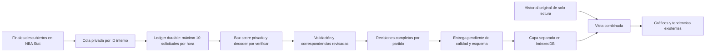

# NBA Stat: prueba manual preparada, sincronización desactivada

Revisión documental: 21/10/2026. **No se han realizado consultas autenticadas, creado tokens, descargado box scores reales ni publicado estadísticas NBA Stat.** No hay cambios en la web activa ni en sus bases personales. Este módulo no se importa desde `main.jsx`, ningún componente ni el workflow del calendario.

## Qué sabemos y qué no

La [documentación oficial](https://nbastat.io/developers/api) describe `GET /api/v1/games/{game_id}/boxscore`, autenticación Bearer y diez consultas por ventana móvil de sesenta minutos. Los IDs son internos; no equivalen a los de NBA, ESPN o BALLDONTLIE. Las colecciones usan página y tamaño de hasta cien. El endpoint de box score puede devolver jugadores vacíos para encuentros pendientes.

La documentación consultada no muestra un esquema completo de los campos del box score, sus unidades de minutos, DNP, totales de equipo o cuartos. La cobertura 2026-27 ha sido confirmada por correo según el usuario; no se ha comprobado aún en una respuesta. No se ha encontrado una especificación OpenAPI enlazada que resuelva esos campos. `decodeNbaStatResponse()` lanza deliberadamente `WIRE_SCHEMA_UNVERIFIED`; **no se ha escrito un adaptador que adivine claves del JSON real**.

El usuario ha comunicado el 21/10/2026 una autorización definitiva por correo para recuperar, normalizar, almacenar y publicar JSON en este proyecto público, gratuito y no comercial, y la confirmación de cobertura 2026-27. Se registra como permiso confirmado **según declaración del usuario** (`permissionEvidence: user-reported-email`); no se ha inspeccionado ni publicado el correo. Este permiso específico no se interpreta como una licencia general para otros proyectos. Conservar el correo privadamente y cumplir las condiciones del proveedor.

La atribución exigida se conserva literalmente en la configuración y en el resumen de la prueba:

> Statistics sourced from NBA Stat and published with permission. NBA Stat is not affiliated with or endorsed by the NBA.

`nbastat-source.json` sigue con `enabled: false` y `responseSchema: unverified`. La autorización resuelve el bloqueo de permisos comunicado, **no certifica todavía la calidad, el esquema o las identidades de una respuesta**. La ingestión, la publicación de estadísticas y la sincronización automática permanecen desactivadas. La prueba manual descrita a continuación activa únicamente una inspección estructural de un endpoint fijo.

## Archivos preparados

- `scripts/lib/nbastat/client.mjs`: transporte exclusivamente de servidor, bloqueo por configuración, rutas documentadas de identificación/descubrimiento/box score, cuota compartida y errores sin cuerpos crudos ni credenciales.
- `scripts/lib/nbastat/private-store.mjs`: ledger durable en una subcarpeta de `work/` (ya ignorada), escritura atómica, archivo `0600`, directorio `0700` y bloqueo exclusivo entre procesos. No usa `public/` ni artefactos. No guarda el token. Un lock dejado por un proceso muerto requiere revisión manual; no se elimina a ciegas ni se reinicia la cuota.
- `src/data/nbastat/updates.js`: correspondencias revisadas, contrato interno, validación, DNP separados, revisiones por partido, vista combinada de lectura y cola deduplicada con reintentos diferidos.
- `src/data/nbastat/store.js`: capa IndexedDB **independiente**, `nba-tendencias-nbastat-private`, con revisión local para evitar sobrescrituras entre pestañas. No se abre en la aplicación actual. Las pruebas la abren únicamente en `fake-indexeddb`.
- `tests/fixtures/nbastat.js`: ejemplos mínimos **FICTICIOS**, con nombres e IDs inventados y `synthetic: true`, en fechas de 2031. Representan nuestro contrato propuesto, **no una respuesta real del proveedor**. Sus filas convertidas también indican «DEMOSTRACIÓN FICTICIA» y no pueden combinarse con un historial marcado como real/importado no sintético. No se incluyen en el build ni se presentan como partidos NBA reales.

## Flujo futuro y separación del historial

No se actualiza `nba-tendencias-personal`, ni sus 93.224 registros, ni las bases de las 519 plantillas y las 434 identidades vinculadas. Las retiradas siguen en su directorio actual. El calendario BALLDONTLIE permanece independiente. Las funciones nuevas no cambian esos estados ni asignan equipos actuales a partir del box score.

Las correspondencias del nuevo proveedor se guardarán por separado: ID NBA Stat → clave NBA/ESPN ya contrastada. Exigen IDs, fechas de nacimiento coincidentes, revisión y referencias a ambos perfiles. Una URL del detalle API identifica su ID interno; habrá que verificar en privado qué campos de identidad ofrece. Si no permite comprobar la identidad, se mantiene pendiente. No se compara solo el nombre ni se reutiliza el número NBA como si fuera un ID NBA Stat.

Los registros usan `nbastat:game:ID:player:ID` y `nbastat:game:ID:team:ID`. El mismo partido recibe revisiones, no nuevos IDs. Las equivalencias con partidos ESPN/BDL se revisarán expresamente. Si ya hay registros del mismo encuentro en el historial, o un posible cruce del mismo día/equipos, la vista lo retiene como conflicto y evita sumarlo dos veces; no modifica la base ni enlaza partidos automáticamente por fecha. Este control conservador puede requerir revisión de un aplazado o una fecha ambigua.

La configuración y el código del módulo se pueden revisar sin publicar las correspondencias, respuestas privadas ni archivos históricos. Un esquema de importación/entrega público no equivale a permiso para publicar su contenido.

## Actuaciones, equipos y correcciones

El contrato interno requiere fecha inequívoca, temporada, marcador final, ambos equipos revisados y confirmación de que el lote está completo. Esa confirmación no existe aún como campo comprobado del proveedor: deberá establecerla el decoder después de revisar una muestra y los criterios de completitud. El contrato exige todos los indicadores de jugador usados por el motor; rechaza ausencias y tiros/puntos contradictorios.

- `played: true`: actuación realmente acreditada. Puede tener cero puntos; cero por sí solo no significa DNP. Minutos se expresan en unidades decimales del contrato, pendientes de conversión del formato real.
- `played: false`: DNP comunicado, separado de las actuaciones. Datos positivos contradictorios se rechazan. No aparece como un partido a cero en los gráficos.
- Participación desconocida o identidad no enlazada: lote pendiente; no se clasifica como «sin historial» ni se escribe una revisión parcial.
- Un jugador ausente del box score no se considera DNP por comparación con la plantilla. No se crean actuaciones para completar una lista.
- Los puntos individuales deben sumar el marcador. Para equipos se exige ambos conjuntos, totales y periodos reales, incluidas prórrogas si existen. Se contrastan tiros y otros totales aditivos; los rebotes de equipo pueden incluir rebotes no asignados a jugadores y no se fuerza su igualdad.
- Si no se dispone de datos de equipo, se pueden preparar solo jugadores con `teamPending: true`. No se inventan cuartos ni se usa el marcador como un box score completo. Si se aportan equipos incompletos/incoherentes, se rechazan. Una revisión con equipos completos no se sustituye por otra que los omita.

Cada revisión mantiene su hora de recepción y filas ordenadas. Repetir la misma revisión no añade registros; las antiguas se ignoran y dos contenidos distintos con la misma hora se rechazan. Una revisión más reciente reemplaza el partido completo **solo en la capa nueva**. La validación falla antes del guardado ante lotes incompatibles. No se interpreta ausencia de un partido en una página como una orden de borrar.

`composeNbaStatView()` construye la vista sin cambiar los originales y aplica las correspondencias existentes de lectura. Se pasan sus registros a las funciones actuales `filterRows`, `summarize` y `detectTrends`: primero filtros, después últimas 5/10/15/20 o muestras mayores. Se conserva el historial de equipos anteriores. El selector de retirados y las exclusiones de tendencias se aplicarán con el directorio actual, sin eliminar sus contribuciones históricas de los equipos. **Ese enganche a React sigue sin activarse**.

## Cuota, reanudación y credenciales

El límite es de cuenta, no por token ni por endpoint. El cliente comparte el ledger entre descubrimiento, perfiles y box scores; persiste una reserva **antes** de HTTP. Fallos y timeouts también consumen reservas. Un reinicio no limpia el ledger. Un error al persistir impide enviar la petición. No se añaden solicitudes paralelas fuera del lock.

Al llegar al límite devuelve `notBefore`; la cola conserva el trabajo para otra ejecución. No duerme una hora en Actions. Un 429 no provoca reintentos inmediatos. Ante presupuesto agotado comunicado por el proveedor se bloquea conservadoramente otra hora y se respeta una espera mayor si se indica. No se adivinan las unidades de `RateLimit-Reset`, aún pendientes de comprobar; esta cautela puede reducir temporalmente el rendimiento. Otras herramientas de la misma cuenta deberán compartir el presupuesto; no se rotan tokens ni crean cuentas para multiplicarlo.

Para la implementación futura: descubrir finales por intervalos solapados de fechas, recorrer todas las páginas, guardar el avance solo después de procesar una página completa y encolar IDs idempotentes. Una corrección vuelve a encolar el mismo ID. Solo retirar la tarea tras guardar una revisión válida; si faltan estadísticas o se acaba la cuota, reprogramarla. La cola en memoria tiene funciones de selección/fin/reintento y su snapshot de navegador es durable; **falta el orquestador de servidor, su checkpoint de descubrimiento y su programación**. No se afirma que la sincronización esté funcionando.

Con quince partidos finalizados no caben quince box scores más descubrimiento/revisiones en una sola ventana. Habrá cola y varias ventanas; no se promete actualización inmediata. Identificar jugadores nuevos también consume solicitudes y puede necesitar horas adicionales. El cliente admite listas paginadas de jugadores (hasta cien por página) para descubrir IDs con menos consultas; esto no garantiza que esas listas incluyan nacimiento ni evita la verificación de identidad.

El token será `NBASTAT_API_TOKEN` en GitHub Actions Secrets para la prueba manual descrita abajo. Nunca `VITE_…`, parámetros URL, navegador, CSV, snapshots, logs, artefactos ni este repositorio. No se ha creado ni leído ese secreto. El cliente recibe el token solo en memoria del servidor y no devuelve encabezados de autorización ni errores originales de red.

## Entrega autorizada de incrementos: implementación pendiente

GitHub Pages no ejecuta un recolector seguro ni puede acceder a IndexedDB con el navegador cerrado. Un recolector externo autorizado puede trabajar sin la web abierta; las escrituras del navegador y el refresco de gráficos necesitan abrirla.

Tras verificar calidad y esquema, preparar el canal JSON público autorizado: manifiesto de toda la temporada con revisiones, la atribución literal requerida, IDs estables y paquetes por partido. El navegador descargará desde su checkpoint y aplicará las revisiones en su capa separada; el manifiesto completo permitirá recuperar semanas sin abrir la web. Nunca se envían a Actions los históricos privados del navegador.

## Primera prueba manual: Boston @ Detroit, 20/10/2026

Caso comunicado por el proveedor a través del usuario: NBA Stat **1369**, `GET /api/v1/games/1369/boxscore`, Detroit 121–Boston 113, 35 registros de jugadores. Estos datos son una referencia comunicada, **no una comprobación realizada por esta integración**. Treinta y cinco registros no equivalen a treinta y cinco participantes. No se necesita gastar una consulta buscando un ID ya facilitado. No usar el ID BALLDONTLIE 21717855 como ID NBA Stat.

### Configurar el secreto (sin programar)

1. Acceder a [NBA Stat](https://nbastat.io/), iniciar sesión y abrir el perfil, apartado de acceso API. Crear el token conforme a la [documentación oficial](https://nbastat.io/developers/api). Se muestra una sola vez. Copiarlo directamente al secreto, sin `Bearer `, espacios añadidos ni comillas. No enviarlo al chat, subirlo como archivo o fotografiarlo.
2. En GitHub abrir `oliver07atm/nba-tendencias` → **Settings → Secrets and variables → Actions → Secrets → New repository secret**.
3. Nombre exacto: **`NBASTAT_API_TOKEN`**. En «Secret», pegar el token y pulsar **Add secret**. Es un secreto de Actions, no una variable, un archivo `.env` publicado ni una variable `VITE_*`. No cambiar `BALLDONTLIE_API_KEY`.
4. Avisar de que está configurado **sin comunicar su valor**. No se ha ejecutado ni programado esta consulta al preparar el código. Guardar un secreto no dispara el workflow.

### Ejecución posterior, solo tras confirmar la configuración

En **Actions → NBA Stat - prueba manual 1369 (sin publicar estadísticas) → Run workflow**, escoger **main**, escribir `INSPECT_1369` y marcar la confirmación únicamente si la cuenta lleva al menos 60 minutos sin consultas y no hay otros clientes activos. El límite pertenece a la cuenta; no se controla el consumo desde otras herramientas. No habilitar logs de depuración, volcar el entorno ni ejecutar comandos de prueba con el token. No hace falta un servicio nuevo ni una clave adicional.

La primera fase hace **una sola petición** a `/api/v1/games/1369/boxscore`, sin reintentos ni llamadas auxiliares. El token solo está disponible en ese paso del runner. Una respuesta correcta produce un resumen de Actions con rutas y tipos de campos, sin valores, nombres, IDs de jugadores ni estadísticas. Ese resumen de estructura puede ser público. El JSON crudo no se imprime, guarda en archivos, sube como artefacto ni se incluye en Pages. Existe solo en memoria del proceso durante la inspección. Una ejecución verde acredita recepción JSON y estructura; **no acredita aún partido correcto, marcador, participación, identidades ni calidad**. Ante fallo se muestra solo un código seguro; no el cuerpo HTTP ni el error crudo.

`github-quota.mjs` mantiene la cuota en una rama separada `nbastat-probe-quota`, exclusivamente con timestamps (`version`, `attempts`, `blockedUntil`), nunca estadísticas ni credenciales. El workflow serializa ejecuciones. Cada reserva se sube **antes de HTTP**, con comparación del commit anterior para impedir carreras. Un fallo de persistencia impide la consulta; una petición fallida conserva su reserva. No borrar esta rama para reiniciar la cuota. El cliente respeta diez solicitudes por ventana móvil de 60 minutos y el bloqueo de 429/Retry-After. Un runner terminado antes de reservar no consume petición; si termina después, la reserva permanece. No hay esperas de una hora consumiendo minutos de Actions.

El workflow necesita el `GITHUB_TOKEN` estándar con permiso `contents: write` (ya declarado) y permiso para crear esa rama; no pide un PAT. Si una política del repositorio impide la escritura, falla antes de consultar. No elimina protecciones. No modifica el workflow diario de BALLDONTLIE ni publica datos al escribir la rama de cuota. Esta cuota deberá compartirse con cualquier orquestador futuro, que aún no está activado.

### Siguiente fase después de obtener la estructura

Revisar los campos reales del resumen, implementar el decoder y efectuar otra consulta controlada para comprobar valores sin publicar el cuerpo crudo. Revisar fecha/temporada/equipos/estado y marcador 121–113, número real de registros y duplicados, DNP/participación/desconocidos, unidades de minutos, totales, tiros y cuartos disponibles. La documentación no da el esquema completo: hoy no se suponen claves para hacer esas comprobaciones.

Verificar IDs internos NBA Stat contra las identidades NBA/ESPN ya contrastadas mediante perfiles, IDs y nacimiento. Cade Cunningham u otros no se dan por participantes por figurar en una plantilla. Si faltan datos o evidencia, el lote se mantiene pendiente; no inventar ceros o cuartos. Comparar P/R/A/triples con fuentes originales y probar en una copia local que la nueva actuación entra en gráficos y tendencias 5/10/15/20, conservando partidos de equipos anteriores. Repetir el lote y una corrección debe mantener IDs y no duplicar. Confirmar hashes/recuentos de los originales y aportaciones históricas de equipos.

Solo después de esas comprobaciones se podrá habilitar la entrega autorizada, mostrar la atribución en las vistas que usen esos datos e integrar la cola incremental. El ensayo estructural no publica estadísticas ni cambia las 93.224 filas, las 519 fichas, las 434 correspondencias o las retiradas. La sincronización masiva sigue desactivada.

## Verificación actual

`npm test` incluye once pruebas de la infraestructura y seis adicionales del probe con fixtures y HTTP simulados: gates, identidades, DNP/cero/desconocido, coherencia, revisiones, históricos entre equipos, ventanas y tendencias, cuota durable, fallos/429, rutas, permisos de archivo y conflicto de pestañas. `npm run build` comprueba que la web existente sigue compilando. Las pruebas simuladas no certifican exactitud ni cobertura efectiva de datos reales NBA Stat; los permisos se registran según la confirmación del usuario.
